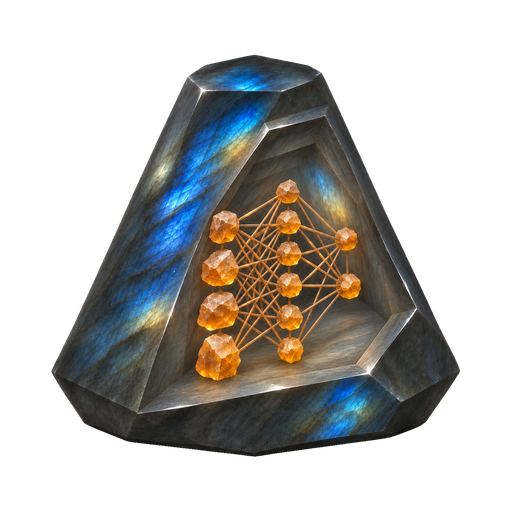

# Elixis brand mark

Labradorite shell with a criss-cross perceptron lattice (4, 5, then 2 nodes) in raw, low-gloss citrine, inside an open, daylit chamber.

| File | Size | Use |
|---|---|---|
| `elixis.png` | 1024×1024 | Master, transparent background |
| `elixis-512.png` | 512×512 | README hero, app icon |
| `elixis-192.png` | 192×192 | PWA and touch icon |
| `elixis-32.png` | 32×32 | Favicon raster |

Part of the KyaniteLabs crystal icon family. Approved at the owner's eye-gate on 2026-11-10. Lockup: **ELIXIS** in Chakra Petch Bold 700 with "by KyaniteLabs" in Chakra Petch Medium 500. The reasoning is in `docs/DESIGN-PREFLIGHT.md`.
